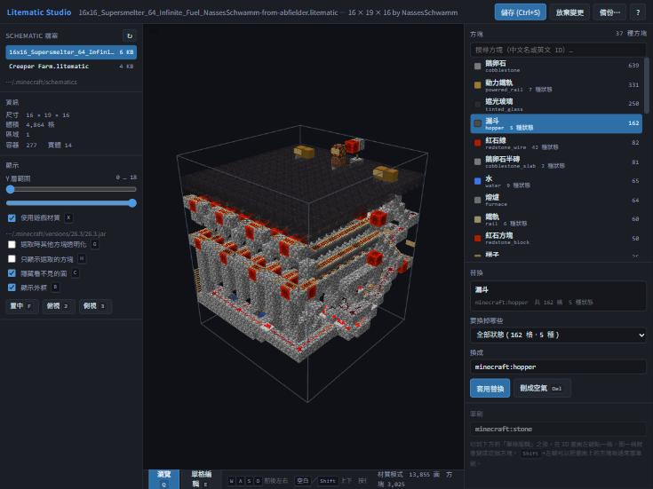

# Litematic Studio

A local web tool to **preview and edit Litematica `.litematic` schematics**, rendered with the
real block models and textures read straight out of your installed Minecraft client.

Everything runs on `127.0.0.1`. Your schematics are never uploaded anywhere.

[繁體中文說明在下面](#litematic-studio-繁體中文)



## Features

**View**

- Real textures and real block models — stairs, slabs, trapdoors, hoppers, repeaters and
  campfires are drawn from the game's own `blockstates` / `models` / `textures`, not from
  approximate boxes. The client jar is located automatically.
- Minecraft's own face shading (up 1.0, down 0.5, north/south 0.8, east/west 0.6), plus biome
  tint for grass, leaves, water and redstone dust (which also follows its `power` level).
- **Localized block names.** Block names come from the game's own language file, read out of
  the launcher's asset store (Traditional Chinese by default, falling back to zh_hk / zh_cn,
  then to the raw English ids). Blockstate properties are translated too — `facing=west`
  reads as `朝向 西` — from a table in `web/blocks.js`.
- Y-layer range sliders to slice the build open one layer at a time.
- Hover any block for its name, its translated state, the raw blockstate and its coordinates.
- The block list doubles as a material list, one row per block with its state count. Click a
  row to highlight every block of that kind in 3D.
- **Fly around with `W` `A` `S` `D`, `Space` and `Shift`**, hold `Ctrl` to go three times
  faster. The camera is a flight camera, not an orbit camera: **right-drag turns your own
  view** (it does not spin the schematic), the wheel moves you along your line of sight,
  middle-drag pans, and the **left button does nothing but select blocks**. Press `?` for
  the full shortcut list.
- A plain coloured-box mode for when you want speed over fidelity on huge builds.

**Edit**

- Pick a block, then choose from a dropdown whether to replace **all of its states at once**
  or just **one specific state** — all the trapdoors, or only the ones facing west.
  State properties are carried over to the new block where it actually has them.
- Delete blocks (replace with air).
- Single-block edit mode: put a block in the **brush** field, switch to 單格編輯, then left
  click a block in the 3D view to turn it into the brush block. Shift+click picks the block
  under the cursor into the brush, Ctrl+click deletes to air.
- `Ctrl+S` saves. Every save copies the previous file into `backups/` first, and you can
  restore any backup from the UI.

## Requirements

- Python 3.9+
- A Minecraft client jar for textures (optional — the tool falls back to coloured boxes).
  Any `versions/<version>/<version>.jar` from a vanilla launcher, MultiMC, Prism, HMCL, etc.

## Running

Windows: double-click `start.bat`. Linux/macOS: `./start.sh`. Either one installs
`litemapy` if it is missing and opens <http://127.0.0.1:8731/>.

Manually:

```bash
pip install -r requirements.txt
python server.py
```

By default the parent directory of the tool is used as the schematics folder — drop the
`litematic-studio` folder straight into your `schematics` directory and it just works.
To point it somewhere else:

```bash
python server.py "/path/to/schematics" --port 8731
```

The client jar is found automatically by walking up from the schematics folder looking for a
`versions/` directory. To choose one yourself, or to skip textures entirely:

```bash
python server.py --jar "/path/to/.minecraft/versions/1.21.4/1.21.4.jar"
```

```bash
python server.py --no-textures
```

On the first run, three.js is downloaded into `vendor/`. After that the tool works offline.

## Blockstate syntax

The same syntax as vanilla commands. The `minecraft:` namespace may be omitted.

```
stone
polished_deepslate_slab[type=top]
minecraft:oak_stairs[facing=east,half=bottom]
```

## Things worth knowing

- **Properties are filtered when replacing across block ids.** Going from
  `chest[facing=south,type=right,waterlogged=false]` to `barrel` keeps only `facing=south`,
  because a barrel has no `type` or `waterlogged`. Going from `spruce_trapdoor` to
  `warped_trapdoor` keeps all five properties. For a block the tool does not know (modded
  blocks), every property is dropped — a missing property gets the game's default, a bogus one
  breaks the block. The tables are `SUFFIX_PROPS` / `EXACT_PROPS` in `server.py`; add to them
  as needed.
- **Block entities are dropped when the block id changes.** Replacing a chest with stone
  removes that chest's contents from the file rather than leaving an orphaned TileEntity
  behind. Changing only the state of the same block id keeps it.
- **Edits live in memory until you save.** The header shows an unsaved marker until you do.
- If the schematic is already loaded in-game, reload it in Litematica after saving.
- Chests, signs, beds and other block entities have no block model in the resource files
  (the game draws them separately), so they fall back to an approximate coloured box.
- Block names need the launcher's `assets/` store (the jar itself only ships English). If it
  cannot be found the list shows English ids and everything else still works.
- Only the vanilla assets inside the jar are read; resource packs are not applied yet.
  `uvlock` is not implemented either, so a few rotated blocks have their texture facing
  the wrong way.
- Very large schematics (millions of blocks) take a few seconds to build. Narrow the Y range
  or switch off textures.

## How it works

```
server.py        HTTP server + .litematic read/write via litemapy
assets.py        parses blockstates / models / textures out of the client jar
                 and bakes each blockstate into a list of textured quads
web/index.html   UI
web/app.js       atlas building, mesh building, picking, editing
web/blocks.js    fallback colour + shape table, biome tints
vendor/          three.js (downloaded on first run)
backups/         automatic pre-save backups
```

Block data is sent to the browser as the raw palette-index array plus the palette, so the
page holds the same structure the file does. Edits are applied to an in-memory `Schematic`
on the server; palette-level replacements are `O(1)` because Litematica stores blocks as
indices into a palette.

The baker resolves `variants` and `multipart` blockstates, walks the model `parent` chain,
applies element rotation, blockstate `x`/`y` rotation and face UV rotation, then emits quads
in 0..1 block space. The browser packs the referenced textures into an atlas, classifies each
one as opaque / cutout / translucent by inspecting its alpha, and merges everything into one
buffer geometry per material.

One trap worth recording: in a `.litematic` region, `Position` is the *maximum* corner when
the corresponding `Size` component is negative, while index 0 of the block array is always the
*minimum* coordinate. Mapping store index to world position is `min + index` on every axis,
never `Position ± index`.

## Contributing

Issues and pull requests welcome. Useful things to pick up:

- resource pack support (read packs on top of the jar)
- `uvlock`
- block entity models (chests, signs, beds)
- a region/box selection tool for scoped fill and replace

## License

MIT — see [LICENSE](LICENSE). Third-party notices are in [NOTICE.md](NOTICE.md).

No Minecraft assets are included in or redistributed by this repository; textures are read at
runtime from the copy of the game you already have. Not affiliated with Mojang Studios.

---

# Litematic Studio（繁體中文）

在瀏覽器裡**預覽並編輯 `.litematic`**，直接讀你本機安裝的 Minecraft，用遊戲真實的方塊模型與材質算繪。

完全跑在 `127.0.0.1`，schematic 不會上傳到任何地方。

## 能做什麼

**看**

- 真實材質與真實模型：樓梯、半磚、地板門、漏斗、紅石中繼器、營火都是照遊戲自己的
  `blockstates` / `models` / `textures` 畫的，不是近似方塊。客戶端 jar 會自動找到。
- 面的明暗照 Minecraft 的規則（上 1.0、下 0.5、南北 0.8、東西 0.6），草地、樹葉、水、
  紅石線會套生物群系染色，紅石線還會照 `power` 變色。
- **方塊名中文化**：直接讀遊戲自己的語言檔（從啟動器的 assets 儲存區取出 zh_tw，
  找不到就退 zh_hk / zh_cn，再找不到就顯示英文 ID）。方塊狀態也翻譯，
  `facing=west` 會顯示成「朝向 西」，對照表在 `web/blocks.js`。
- Y 層範圍雙滑桿，可以一層一層剖開看。
- 滑鼠移到方塊上，左上角顯示中文名、翻譯後的狀態、原始 blockstate 與座標。
- 右欄清單就是材料表，一種方塊一列並標出有幾種狀態，點一下就在 3D 中高亮。
- **用 `W` `A` `S` `D`、`空白`、`Shift` 飛行移動**，按住 `Ctrl` 加速三倍。
  視角是飛行視角不是環繞視角：**右鍵拖曳是轉自己的頭**（不會把藍圖轉來轉去）、
  滾輪沿著視線前進後退、中鍵拖曳平移，**左鍵只負責選取方塊**。按 `?` 看完整快捷鍵。
- 另有純色塊模式，超大型建築要速度時用。

**改**

- 選一個方塊之後，用下拉選單決定要換掉**全部狀態**還是**其中某一個狀態**
  ——整張圖的地板門全換，或只換朝西的那批。狀態屬性會在新方塊真的有那個屬性時保留。
- 刪成空氣。
- 單格編輯模式：先在「筆刷」欄填一個方塊，切到單格編輯，然後在 3D 畫面左鍵點一格，
  那一格就變成筆刷方塊。Shift+左鍵可以把游標下的方塊吸過來當筆刷，Ctrl+左鍵刪成空氣。
- `Ctrl+S` 儲存，每次存檔前先把舊檔複製到 `backups/`，可以從介面還原任何一份備份。

## 需求

- Python 3.9 以上
- 要材質的話需要一份 Minecraft 客戶端 jar（非必要，沒有就退回色塊模式）。
  原版啟動器、MultiMC、Prism、HMCL 等的 `versions/<版本>/<版本>.jar` 都可以。

## 啟動

Windows 雙擊 `start.bat`，Linux/macOS 執行 `./start.sh`，兩者都會在缺套件時自動安裝
`litemapy`，然後開啟 <http://127.0.0.1:8731/>。

手動：

```bash
pip install -r requirements.txt
python server.py
```

預設把工具的上一層資料夾當成 schematic 來源，所以把 `litematic-studio` 整個丟進
`schematics` 資料夾就能直接用。想指定別的位置：

```bash
python server.py "D:/game/schematics" --port 8731
```

jar 會從 schematic 資料夾往上找 `versions/` 自動判斷。要自己指定或完全不要材質：

```bash
python server.py --jar "D:/.minecraft/versions/1.21.4/1.21.4.jar"
```

```bash
python server.py --no-textures
```

第一次啟動會下載 three.js 到 `vendor/`，之後就能離線使用。

## 方塊寫法

跟原版指令一樣，`minecraft:` 可以省略。

```
stone
polished_deepslate_slab[type=top]
minecraft:oak_stairs[facing=east,half=bottom]
```

## 要注意的事

- **跨方塊 ID 替換時屬性會過濾。** `chest[facing=south,type=right,waterlogged=false]` 換成
  `barrel` 只會保留 `facing=south`，因為木桶沒有 `type` 和 `waterlogged`；`spruce_trapdoor`
  換成 `warped_trapdoor` 則五個屬性全保留。工具不認識的方塊（模組方塊）會把屬性全部捨棄
  ——少帶屬性遊戲會補預設值，帶錯屬性才會把方塊弄壞。對照表是 `server.py` 裡的
  `SUFFIX_PROPS` / `EXACT_PROPS`，不夠就自己加。
- **方塊 ID 改變時會一起移除方塊實體。** 箱子換成石頭時，那格的箱子內容會從檔案移除，
  而不是留下一個孤兒 TileEntity。同 ID 只改狀態則會保留。
- **編輯先改在記憶體裡，按儲存才寫回檔案。** 有未儲存變更時標題列會顯示未儲存標記。
- 遊戲裡已經載入同一個 schematic 的話，存檔後要在 Litematica 重新載入。
- 箱子、告示牌、床這類方塊實體在資源檔裡沒有方塊模型（遊戲是另外畫的），會退回近似色塊。
- 中文方塊名需要啟動器的 `assets/` 儲存區（jar 裡只有英文）。找不到的話清單會顯示
  英文 ID，其他功能不受影響。
- 目前只讀 jar 內的原版材質，還沒支援資源包；`uvlock` 也還沒做，少數轉過向的方塊
  貼圖方向會不對。
- 超大型 schematic（百萬格以上）第一次建模會卡幾秒，縮小 Y 層範圍或關掉材質就會順。

## 運作方式

```
server.py        HTTP 伺服器，用 litemapy 讀寫 .litematic
assets.py        從客戶端 jar 解析 blockstates / models / textures，
                 把每個 blockstate 烘焙成一包帶材質的四邊形
web/index.html   介面
web/app.js       圖集組裝、網格組裝、點選、編輯
web/blocks.js    退回用的顏色與外形表、生物群系染色
vendor/          three.js（第一次啟動時下載）
backups/         儲存前的自動備份
```

方塊資料是用原始的 palette 索引陣列加上 palette 送到瀏覽器，所以網頁端拿到的結構跟檔案
裡的一樣。編輯套用在伺服器記憶體中的 `Schematic` 上；palette 層級的替換是 `O(1)`，因為
Litematica 本來就是用「索引 + 調色盤」存方塊的。

烘焙器會處理 `variants` 與 `multipart`、走完模型的 `parent` 繼承鏈、套用 element 旋轉、
blockstate 的 `x`/`y` 旋轉與面 UV 旋轉，最後輸出 0..1 方塊空間的四邊形。瀏覽器把用到的
材質打包成圖集，讀 alpha 把每張分類成不透明 / 鏤空 / 半透明，再依材質合併成單一
buffer geometry。

一個值得記下來的坑：`.litematic` 的 region 中，當 `Size` 某個分量是負的時候，`Position`
存的是**最大**角，而方塊陣列的索引 0 永遠對應**最小**座標。所以每個軸都是
`最小角 + 索引`，不是 `Position ± 索引`。

## 歡迎貢獻

Issue 和 PR 都歡迎。可以接手的東西：

- 資源包支援（疊在 jar 之上讀取）
- `uvlock`
- 方塊實體模型（箱子、告示牌、床）
- 區域選取工具，讓填滿與替換可以限定範圍

## 授權

MIT，見 [LICENSE](LICENSE)。第三方聲明在 [NOTICE.md](NOTICE.md)。

本專案不包含也不散布任何 Minecraft 素材，材質是執行時從你自己已經安裝的遊戲讀取的。
與 Mojang Studios 無關。
